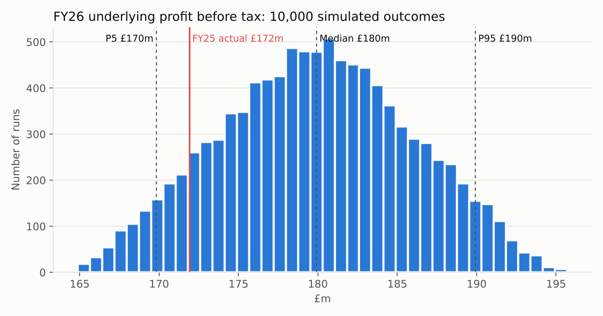
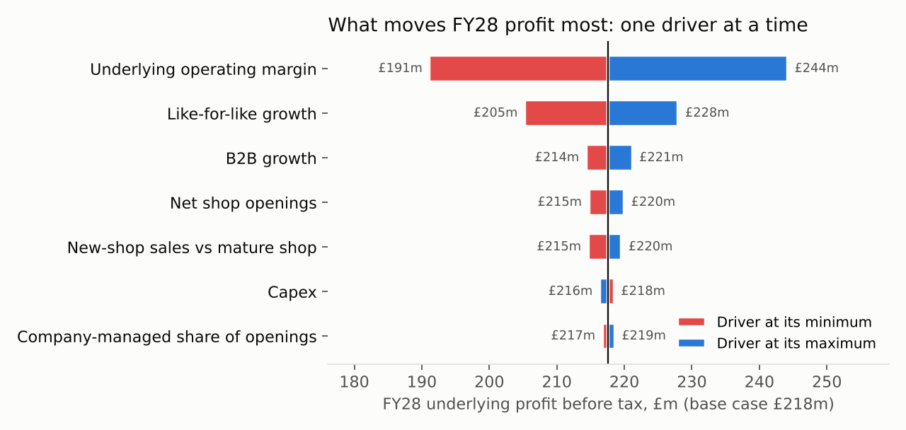

# Greggs plc: driver-based forecast model

A three-statement forecast of **Greggs plc** (LSE: GRG), the UK food-on-the-go retailer, built from five years of published annual reports (FY21–FY25). The model forecasts FY26–FY28 from the business's own drivers: shop openings, like-for-like sales growth, operating margin, capex and working capital. It will be tested against Greggs' reported results and extended with a Monte Carlo simulation of the full three statements.

**Author:** Siddharth Attuluri, BSc Business Management, University of Birmingham; ACCA student
**Status:** work in progress (October 2026). The historical data stage is complete; the forecast is being built.

## Project stages

| Stage | What it covers | Status |
|---|---|---|
| 1. Historical data | FY21–FY25 income statement, balance sheet, cash flow, cash-generated note, revenue split and shop KPIs, each figure referenced to its report page | Done |
| 2. Base-case forecast | FY26–FY28 three statements, linked, balance sheet balancing every year; revenue section built by me | Done (v0.4) |
| 3. Analysis | Base, upside and downside scenarios; FY25 back-test (method within 0.4%); tax-rate reconciliation FY21–FY25; key audit matter mapped to the model | Done (v0.5) |
| 4. Monte Carlo simulation | 10,000 runs of the full three-statement model with ranged, correlated drivers (Python) | Done (v0.6) |
| 5. Live test | FY26 forecast locked before Greggs' January 2027 trading update, then compared with actual results | Planned |

## What is in this repository

```
data/greggs_historicals_fy21_fy25.csv   407 figures: line item, year, value, source report, PDF page
scripts/locate_statements.py            finds the statements and key notes in each annual report
scripts/verify_sources.py               checks every figure is printed on the page it cites
scripts/reconcile.py                    rebuilds every subtotal and ties it to the reported totals
scripts/build_workbook.py               builds the Excel model from the CSV
model/GRG_model_v0.6.xlsx               the current Excel model: assumptions, revenue build, FY26–FY28 forecast, scenarios, back-test, tax and audit review, simulation results
simulation/monte_carlo.py               Monte Carlo engine: re-implements the model in Python and runs 10,000 scenarios
simulation/charts.py, add_to_workbook.py  charts and the Simulation tab
simulation/results/                     percentiles, probabilities, tornado table, run-level outputs, charts
```

## Controls: how the historical data is checked

Two independent checks, both run from the data file:

1. **Source check** (`verify_sources.py`): every non-zero figure is searched for on the PDF page it cites. Current result: **352 of 352 testable figures found**. 52 zeros (printed as dashes) cannot be tested this way, and 3 figures are derived from note lines; the working for each is in the `note` column.
2. **Reconciliation** (`reconcile.py`): 13 checks rebuild operating profit, profit before tax, total assets, net assets, the balance sheet, cash movements and shop numbers from their components and tie them to the reported totals. Current result: **all 13 checks tie in all five years.**

The first check proves each number exists on its page; the second proves the numbers sit in the right rows, because a misplaced figure would break a total.

## How AI was used

This project uses Claude (Anthropic) as an assistant, and is open about where:

- **AI-assisted:** locating the statements in the reports, transcribing the figures into the data file with page references, and writing the Python scripts and the workbook structure.
- **Checked by code:** every transcribed figure, through the two controls above.
- **My part:** choosing the company and approach, every forecast assumption and the reasoning behind it, the scenario and simulation ranges, building the revenue section of the model, and the interpretation of results.

## Monte Carlo simulation

Three scenarios show the extremes; the simulation shows how likely each outcome is.

- **Method:** each uncertain driver (openings, company-managed share, like-for-like growth, new-shop sales, B2B growth, margin, capex, tax rate, restructuring cost) gets a triangular distribution (min / most likely / max) from the Drivers tab. Like-for-like growth is linked to margin (correlation 0.5) and to B2B growth (0.3) with a Gaussian copula. Each run recalculates all three statements for FY26–FY28.
- **Controls:** the Python base case equals the Excel base case to £0.0m on revenue, profit, cash and free cash flow, and the balance sheet balances in all 30,000 run-years.

| FY26 underlying profit before tax | P5 | Median | P95 |
|---|---|---|---|
| £m | 169.8 | 179.9 | 189.9 |

- About a 90% chance FY26 underlying profit before tax beats FY25 (£171.9m).
- Cash stays positive in every run (1% chance it dips below £50m), so no new borrowing is needed.
- Margin is by far the biggest driver of FY28 profit (a £53m swing across its range), followed by like-for-like growth (£23m).




## Presentation choices

- Interest received is shown in operating cash flow for every year, following Greggs' FY25 accounting policy (FY24 was restated). FY22 and FY23 operating and investing subtotals therefore differ from those years' reports by 1.4 and 6.1; the net change in cash is unchanged.
- FY21 and FY22 finance income and expense are split using the finance note, because the income statement shows only a net figure.
- Each year is taken from the following year's report where possible, so restated comparatives are used.
- FY21 is affected by Covid (like-for-like growth of 52.4% against 2020), so forecast ratios are based on FY22–FY25.

## Reproducing the checks

Requirements: Python 3.10+, `openpyxl`, `numpy`, `scipy`, `matplotlib`, and `pdftotext` (from poppler-utils).

```bash
pip install -r requirements.txt
# place the annual reports in sources/ as AR21.pdf ... AR25.pdf (see sources/README.md)
python scripts/locate_statements.py
python scripts/verify_sources.py
python scripts/reconcile.py
python scripts/build_workbook.py
python simulation/monte_carlo.py --workbook model/GRG_model_v0.5.xlsx
python simulation/charts.py
```

The annual reports are not stored here; they are published by Greggs plc on its investor website.

## Disclaimer

A personal, educational project based only on public information. It is not investment advice and is not affiliated with or endorsed by Greggs plc.
